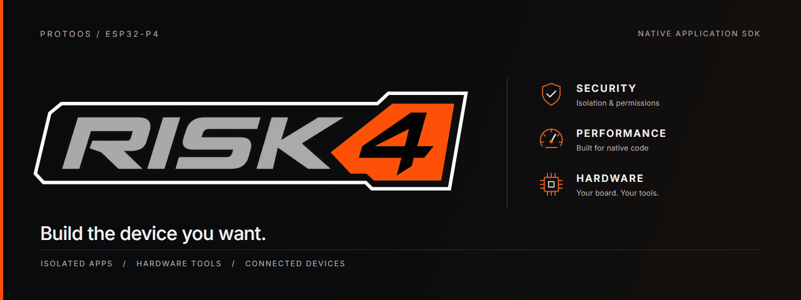

<p align="center">
  
</p>

<p align="center"><strong>A next-generation microcontroller platform.</strong></p>

<p align="center">
  <a href="docs/build.md">Get started</a> &nbsp;·&nbsp;
  <a href="docs/architecture.md">Architecture</a> &nbsp;·&nbsp;
  <a href="docs/hardware.md">Hardware</a> &nbsp;·&nbsp;
  <a href="examples/README.md">Examples</a> &nbsp;·&nbsp;
  <a href="docs/media.md">Demos</a> &nbsp;·&nbsp;
  <a href="docs/README.md">Docs</a>
</p>

## Build the device you want

RISK4 / ProtoOS is a kernel and application platform for ESP32-P4. Build
hardware tools, connected appliances, custom interfaces or a handheld console.
Install your own native apps without replacing the OS.

- **Isolation:** RISC-V U-mode, PMP memory protection and private thread stacks.
- **Permissions:** kernel-checked capabilities, device handles and trusted prompts.
- **Native apps:** C SDK, installable packages, worker threads and IPC.
- **Hardware:** GPIO, TCP networking, input and audio interfaces.
- **System UI:** graphical shell, private app storage and trusted file dialogs.

Game2D, a software [3D engine](docs/game3d.md), and a fully functional app
Store are part of the platform too.

[Device use cases: hardware tools, communication terminals, appliances and consoles →](docs/use-cases.md)

## Security by design

Native apps run in unprivileged RISC-V U-mode, with PMP restricting memory
access. The kernel authenticates callers, checks permissions and validates
buffer ownership before handling requests. Code and writable data are kept
separate; file and device access goes through owned handles. Permission
prompts and file dialogs are controlled by the kernel.

Micro-ASLR, stack/heap canaries and metadata integrity checks add memory hardening.

[Security features and blocked-attack examples →](SECURITY.md)

## Connectivity

GPIO and TCP networking are available. **I²C, SPI and UART app APIs are on the
roadmap.** See [hardware & connectivity](docs/hardware.md).

## Build an app

With Python 3.10+ and Espressif's `riscv32-esp-elf` GCC 14.2.0 toolchain:

```sh
python build_examples.py
```

Builds [Hello](examples/hello/README.md), [Hello 2D](examples/hello2d/README.md),
[Hello 3D](examples/hello3d/README.md) and the commented
[Pentest demo](examples/pentest/README.md) into `build/`.
[Build and installation instructions →](docs/build.md)

## See it running

[Watch the latest system demo](https://drive.google.com/file/d/1q-zUQuDmM4K1UdG0iUEE-cLgRraXx8d6/view?usp=sharing)

[More demos](docs/media.md), including the Minecraft server and earlier showcase.

## SDK

Public headers, compiled runtime and graphics libraries, examples, linker scripts and build tools. The kernel
is closed source; compatible ProtoOS firmware is supplied separately.

Kernel ABI **26** · Loader **5** · Manifest **5** · RV32 / `ilp32f`

[Platform](docs/platform.md) · [Security](SECURITY.md) ·
[Source snapshot](snapshot.json) · [SDK terms](docs/distribution.md)
