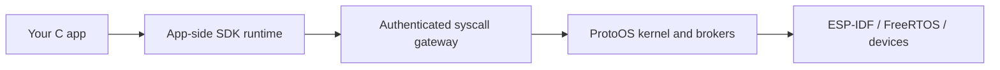

# From application code to the device

An app is a native C program packaged as a ProtoELF `.pelf` bundle. It runs
under ProtoOS rather than replacing the firmware image.

This repository supplies the app-facing headers, compiled runtime and graphics
libraries, linker scripts and host tools. The kernel, brokers, underlying
framework and board drivers are supplied in compatible firmware separately.

## Three pieces developers work with

**Headers describe the interface.** `main/include/` defines shared wire types
and constants. `loaded_apps/sdk/proto_loaded.h` declares app functions such as
allocation, file access and logging. A declaration does not establish that a
particular device or optional feature is available; use runtime discovery.

**Compiled libraries provide the runtime.** The `core` library supplies app
startup, SDK calls and Game2D helpers; `full` adds the Game3D helpers. These
link into your app and call the authenticated kernel interface. Their
implementation sources remain private.

**The tools make an installable app.** The compiler and linker produce a
split RX/RW ELF. The tools validate it, generate the manifest/object table
and package the `.pelf`. Loader ABI 5 uses a fixed RX-to-RW bias for flash XIP;
the matching OS loader enforces its own layout and admission checks.

## Authority stays with the OS

Apps use authenticated syscalls and kernel-mediated handles/buffers. The host
tool's capability scanner assists manifest generation; it cannot approve an
installation or bypass runtime checks. Files are addressed through logical
namespaces such as `/self/`, with caller identity supplied by the kernel.

The design uses U-mode/PMP isolation, but the prototype is not independently
security-certified. See [security notes](../SECURITY.md) and
[interface limits](interface-notes.md) for the current boundary.

## Keep the versions separate

Kernel ABI **26**, loader ABI **5**, and manifest **5** are different
contracts. A successful SDK build proves that the supplied SDK can produce
an app; it does not prove that a different kernel, board or peripheral setup
will accept and run it. Firmware and P4 silicon revisions must match.
